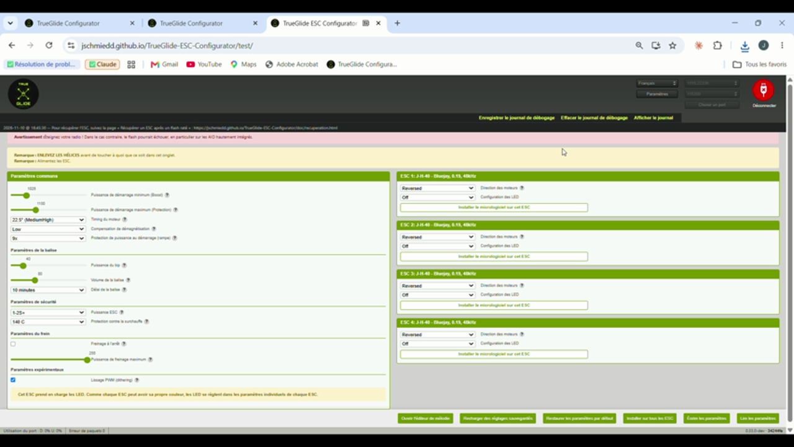

# Why this addendum

The report of 10 November describes the endless hang of an interrupted flash and its fix. While porting all TrueGlide fixes to the current `develop` branch of ESC Configurator (12e45f1), two more points showed up that the report does not explain:

- **A.** after a failed flash, the buttons can stay disabled;
- **B.** connecting and disconnecting, mostly after a passthrough or a failed flash.

TrueGlide had already fixed both before the bench test M6, so the report's tests all ran with these fixes in place. This addendum gives, for each point, the original code, the consequence, the fix and the evidence.

# A. Buttons left disabled after a failed flash

## Original code

`src/utils/FourWay.js`, `writeHex()`, lines 1189 and 1216 of `develop` (12e45f1):

```js
try {
  ...
  return flashTarget(target, flash);
} catch(e) {
  console.debug('Failed flashing SiLabs:', e);
  return null;
}
```

`flashTarget()` is returned **without `await`**, so the `catch` block never sees its failure.

## Consequence

1. When the flash itself fails (for example the ESC loses power), `writeHex()` **rejects** instead of returning `null`.
2. `handleFlashUrl()` (`src/Containers/App/index.jsx`, line 708) awaits `this.flash()` without `try/catch`: the rejection is not handled.
3. So the message "Failed flashing ESC n" is never shown, and `setFlashing(false)` is never called: **all buttons stay disabled** until the page is reloaded.

Flashing a local file (`handleLocalSubmit()`, line 661) does catch the error, so this only affects the usual case: a firmware chosen from the list.

Together with the fix of #588: once the endless hang is fixed, a failed flash ends with exactly this rejection. Without this second fix, the flash would end, but the screen would still look frozen.

## Fix

`return await flashTarget(target, flash);` at both places, so that the existing `catch` blocks handle the failure and `writeHex()` returns `null`.

Test: `writeHex()` with a failing `initFlash()` resolves to `null` (it rejects on the current `develop`). Test run by TrueGlide.

Fixed in TrueGlide on 6 November (internal audit), at both places.

## Evidence on the bench (TrueGlide v24, 10 November)

Both power cuts of test Q6 ended with the failure message, the recovery link and the buttons back:

```
16:45:30  Failed flashing SiLabs: FlashStalledError: No progress for 30000 ms
16:45:30  Flashing ESC 4 failed: do not use this ESC, flash it again
16:51:45  Failed flashing SiLabs: MessageNotOkError: Message not OK
16:51:45  Flashing ESC 4 failed: do not use this ESC, flash it again
```



**Pull request:** included in the "flash" PR (#…), together with the 30 s watchdog.

# B. Connection and disconnection

## What was seen (TrueGlide v22, before the fix, 8 November)

- **"Timed out" after "Port closed".** "MSP command failed: Timed out after 1000ms" was logged 1 s after "Closed port" (19:20:43 and 19:23:07, ports closed at 19:20:42 and 19:23:06).
- **Wrong passthrough detection.** Port reopened at 19:22:24. The API version request timed out once (19:22:25), so the program took the flight controller for being left in passthrough and sent 4-way commands to ESC 1. The board answered in MSP ("invalid message start: 36", 36 being "$", at 19:22:28). Result: "Failed resetting ESC 1 - power cycle" and "Port initialization failed" at 19:22:33. The next attempt, at 19:22:52, worked.

## Causes in the original code

- When the port closes, commands still waiting stay in the queue and time out later against a closed port; data received before a reconnection can be handed to the next command.
- In passthrough the flight controller stops the motor outputs and no longer answers MSP, but closing the port still sends a motor stop, which can only time out.
- A late answer to an earlier MSP command can be taken as the answer to the next command.
- A single late answer to the API version request is enough to take the flight controller for being in passthrough.
- "Disconnect" does not wait for the port to be closed before logging "Port closed".

## Fixes

- The command queue drops every waiting command and the received data when the port opens or closes.
- The motors are marked as stopped when entering the passthrough; the stop is sent while the reader still runs. Without a passthrough, the motors are still stopped.
- Only the answer to the MSP command sent is taken; a command cancelled by the port closing is not logged as a failure.
- The API version is asked up to 3 times, 250 ms apart, on a time out.
- "Disconnect" waits for the port to be closed.

Tests (run by TrueGlide): the queue rejects the current and waiting commands at once and keeps no old data; a late MSP answer is skipped; a cancelled command is not logged; no motor stop is sent after a passthrough, and it still is without one.

TrueGlide also treats an MSP answer ("$") to a 4-way command as "not in passthrough". This is not in the PR, to keep it small.

## Evidence on the bench (TrueGlide v22 with the fixes, 8 November)

Test Q5: 5 disconnection and reconnection cycles, from 20:11 to 20:13:52. Each reconnection worked at the first attempt, in 3 to 6 s. The saved log holds no "Timed out" and no "failed".

**Pull request:** the "connection" PR (#…), which depends on #589.

# License

TrueGlide ESC Configurator is derived from ESC Configurator (stylesuxx/esc-configurator), under the AGPL v3 license. The original code quoted here is from that project. Board identifiers are masked in the logs.
