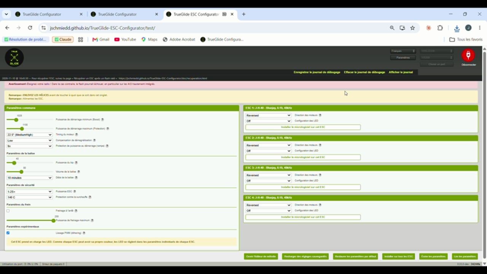

# Pourquoi cette annexe

Le rapport du 10 novembre décrit le blocage sans fin d'un flash coupé et sa correction. En reportant toutes les corrections de TrueGlide sur la branche `develop` actuelle d'ESC Configurator (12e45f1), deux autres points sont apparus, que le rapport n'explique pas :

- **A.** après un flash raté, les boutons peuvent rester grisés ;
- **B.** la connexion et la déconnexion, surtout après un passthrough ou un flash raté.

TrueGlide avait déjà corrigé ces deux points avant l'essai M6 : tous les essais du rapport ont donc tourné avec ces corrections. Cette annexe donne, pour chaque point, le code d'origine, la conséquence, la correction et la preuve.

# A. Boutons grisés après un flash raté

## Code d'origine

`src/utils/FourWay.js`, `writeHex()`, lignes 1189 et 1216 de `develop` (12e45f1) :

```js
try {
  ...
  return flashTarget(target, flash);
} catch(e) {
  console.debug('Failed flashing SiLabs:', e);
  return null;
}
```

`flashTarget()` est renvoyée **sans `await`** : le bloc `catch` ne voit donc jamais son échec.

## Conséquence

1. Quand le flash échoue (par exemple l'ESC perd son courant), `writeHex()` **rejette** au lieu de rendre `null`.
2. `handleFlashUrl()` (`src/Containers/App/index.jsx`, ligne 708) attend `this.flash()` sans `try/catch` : le rejet n'est pas traité.
3. Le message « Failed flashing ESC n » n'apparaît donc jamais, et `setFlashing(false)` n'est jamais appelé : **tous les boutons restent grisés** jusqu'au rechargement de la page.

Le flash d'un fichier local (`handleLocalSubmit()`, ligne 661) attrape bien l'erreur : seul le cas habituel est touché, le firmware choisi dans la liste.

Lien avec la correction #588 : une fois le blocage sans fin corrigé, un flash raté se termine justement par ce rejet. Sans cette 2e correction, le flash se terminerait, mais l'écran resterait figé en apparence.

## Correction

`return await flashTarget(target, flash);` aux 2 endroits : les blocs `catch` existants traitent l'échec et `writeHex()` rend `null`.

Test : `writeHex()` avec un `initFlash()` qui échoue rend `null` (il rejette sur la `develop` actuelle). Test exécuté par TrueGlide.

Corrigé dans TrueGlide le 6 novembre (audit interne), aux 2 endroits.

## Preuve au banc (TrueGlide v24, 10 novembre)

Les 2 coupures de l'essai Q6 se sont terminées par le message d'échec, le lien de récupération et le retour des boutons :

```
16:45:30  Failed flashing SiLabs: FlashStalledError: No progress for 30000 ms
16:45:30  Flashing ESC 4 failed: do not use this ESC, flash it again
16:51:45  Failed flashing SiLabs: MessageNotOkError: Message not OK
16:51:45  Flashing ESC 4 failed: do not use this ESC, flash it again
```



**Pull request :** #592 (« flash »), avec le chien de garde de 30 s.

# B. Connexion et déconnexion

## Ce qui a été vu (TrueGlide v22, avant correction, 8 novembre)

- **« Timed out » après « Port fermé ».** « MSP command failed: Timed out after 1000ms » apparaissait 1 s après « Closed port » (19:20:43 et 19:23:07, ports fermés à 19:20:42 et 19:23:06).
- **Fausse détection de passthrough.** Port rouvert à 19:22:24. La demande de version a expiré une fois (19:22:25) : le logiciel a cru la carte restée en passthrough et a envoyé des commandes 4-way à l'ESC 1. La carte répondait en MSP (« invalid message start: 36 », 36 étant « $ », à 19:22:28). Résultat : « Failed resetting ESC 1 - power cycle » et « Port initialization failed » à 19:22:33. La tentative suivante, à 19:22:52, a marché.

## Causes dans le code d'origine

- À la fermeture du port, les commandes en attente restent dans la file et expirent plus tard contre un port fermé ; des données reçues avant une reconnexion peuvent être données à la commande suivante.
- En passthrough, la carte coupe elle-même les moteurs et ne répond plus en MSP, mais la fermeture du port envoie quand même un arrêt des moteurs, qui ne peut qu'expirer.
- Une réponse en retard à une commande MSP précédente peut être prise pour la réponse à la commande suivante.
- Une seule réponse en retard à la demande de version suffit pour croire la carte en passthrough.
- « Déconnecter » n'attend pas la fermeture du port avant d'afficher « Port fermé ».

## Corrections

- La file de commandes abandonne toutes les commandes en attente et les données reçues à l'ouverture et à la fermeture du port.
- Les moteurs sont marqués arrêtés à l'entrée en passthrough ; l'arrêt est envoyé pendant que la lecture tourne encore. Hors passthrough, les moteurs sont toujours arrêtés.
- Seule la réponse à la commande MSP envoyée est prise ; une commande annulée par la fermeture du port n'est plus notée comme un échec.
- La demande de version est réessayée jusqu'à 3 fois, à 250 ms d'intervalle, en cas d'expiration.
- « Déconnecter » attend la fermeture du port.

Tests (exécutés par TrueGlide) : la file rejette d'un coup la commande en cours et celles en attente, sans garder de vieilles données ; une réponse MSP en retard est ignorée ; une commande annulée n'est pas notée ; aucun arrêt moteur n'est envoyé après un passthrough, et il l'est toujours sans passthrough.

TrueGlide traite aussi une réponse MSP (« $ ») à une commande 4-way comme « pas en passthrough ». Ce point n'est pas dans la PR, pour la garder petite.

## Preuve au banc (TrueGlide v22 corrigée, 8 novembre)

Essai Q5 : 5 cycles de déconnexion et reconnexion, de 20:11 à 20:13:52. Chaque reconnexion a marché du premier coup, en 3 à 6 s. Le journal enregistré ne contient ni « Timed out » ni « failed ».

**Pull request :** #593 (« connexion »), qui suit #589 (fusionnée).

# Licence

TrueGlide ESC Configurator est dérivé d'ESC Configurator (stylesuxx/esc-configurator), sous licence AGPL v3. Le code d'origine cité ici vient de ce projet. Les identifiants de carte sont masqués dans les journaux.
