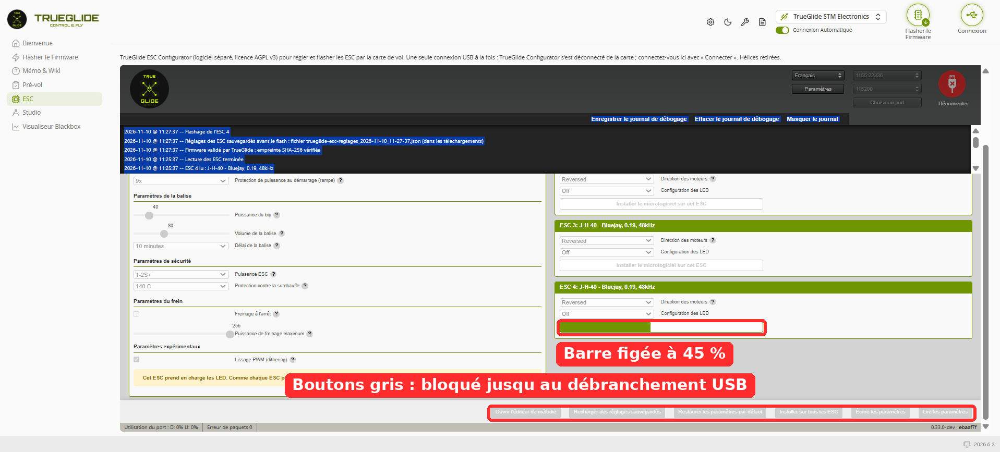
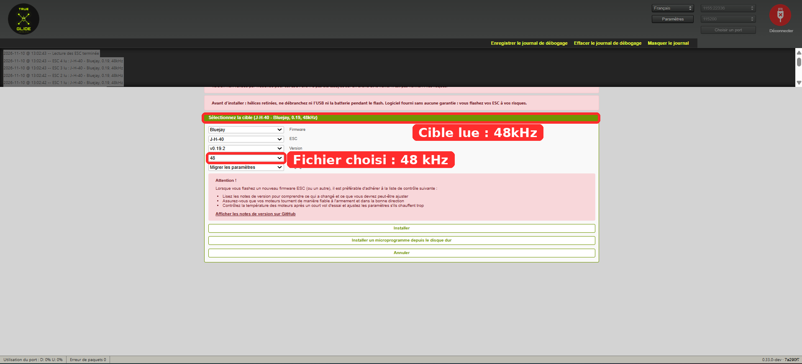
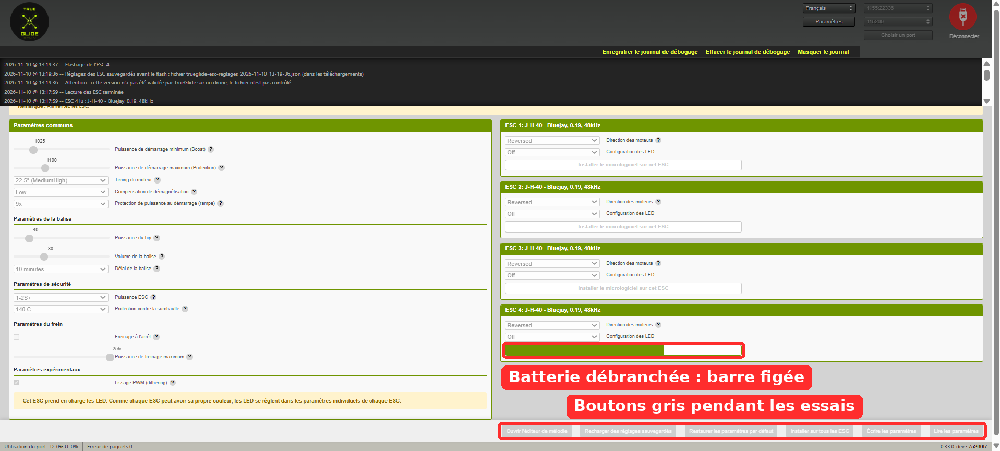
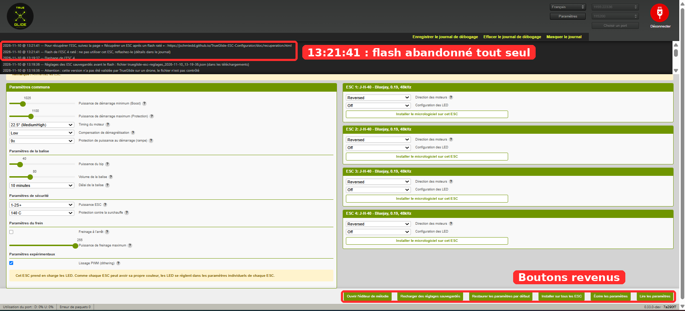
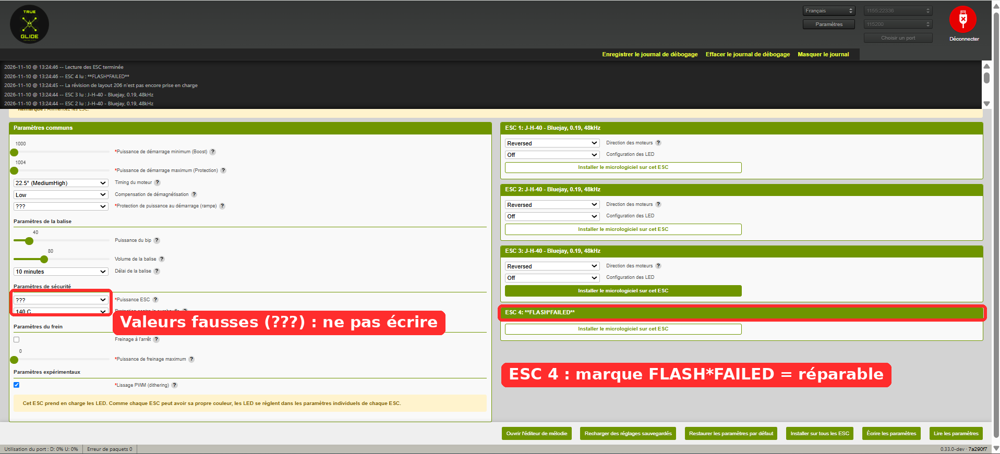
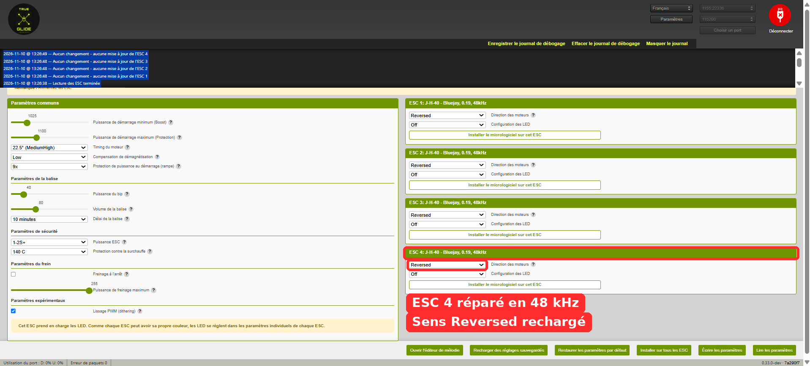
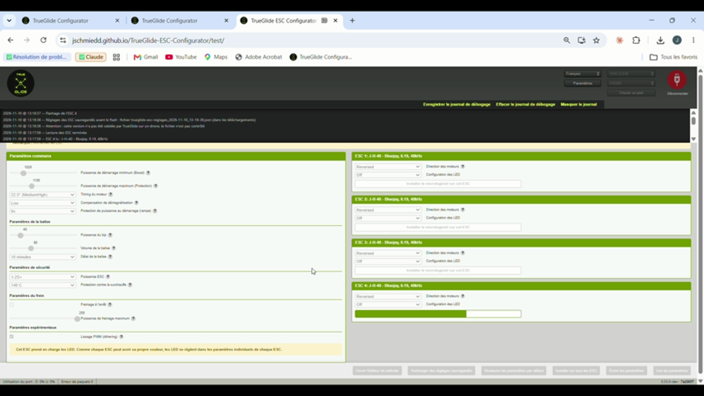
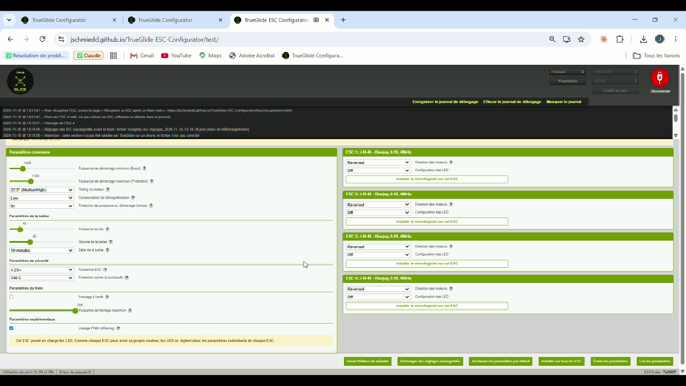
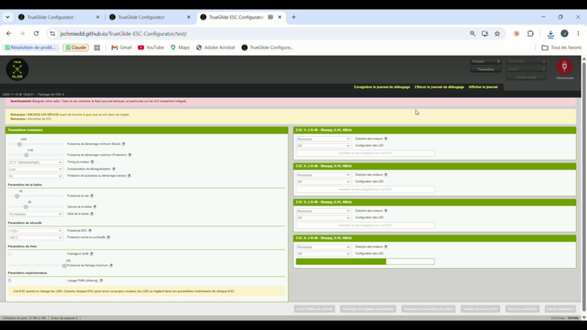
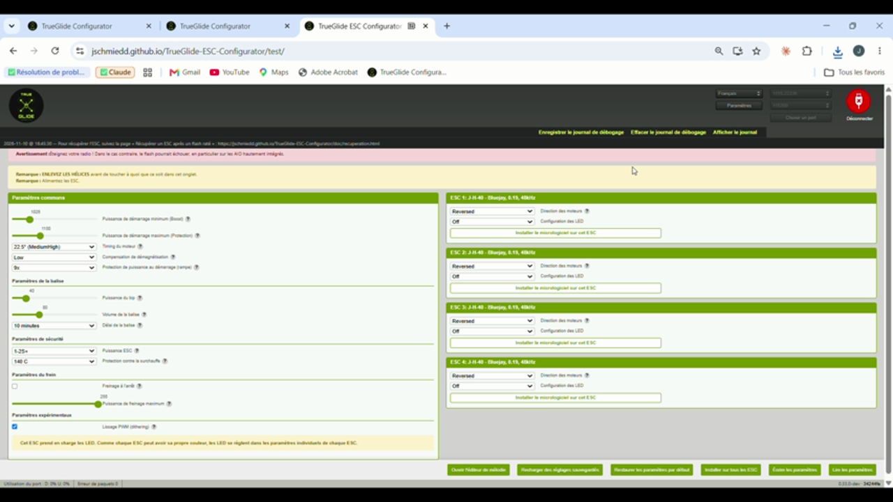

# Résumé

En coupant volontairement le courant d'un ESC pendant son flash, l'essai M6 a mis au jour un défaut d'**ESC Configurator**, le logiciel libre d'origine (stylesuxx/esc-configurator) sur lequel repose TrueGlide ESC Configurator :

- **le défaut :** quand l'ESC perd son courant pendant la vérification du flash, le logiciel reste bloqué sur « Flashage de l'ESC n », tous ses boutons grisés, sans fin. Le seul moyen d'en sortir est de débrancher le câble USB ;
- **la cause :** une erreur perdue dans la fonction qui réessaie les commandes. Elle date des débuts du projet d'origine et existe toujours dans sa dernière version publiée (v0.32.1) comme dans sa version en développement (26/10/2026) ;
- **la correction :** TrueGlide l'a corrigée en une ligne, prouvée par 2 tests automatiques qui échouent sur l'ancien code ;
- **la vérification au banc :** 2 essais sur la version corrigée. Le logiciel abandonne seul le flash en 2 à 2,5 minutes, affiche un message clair, et l'ESC se répare ensuite normalement.

Un 2e essai, l'après-midi, a montré que la coupure pendant l'écriture restait trop longue (environ 14 minutes, jusqu'au rechargement de la page). C'est corrigé en v24 : abandon en moins de 60 s, vérifié au banc (partie 6). L'essai a aussi révélé 4 défauts secondaires (dont le journal effacé par « Enregistrer »), eux aussi hérités du logiciel d'origine. Ils sont corrigés (voir les parties 4 et 6).

# 1. L'essai

| | |
|---|---|
| Matériel | SpeedyBee F405 Mini neuve, firmware TRUEGLIDE 2026.6.2 (cb4e3f0f2, identifié « BTFL » par le logiciel), ESC J-H-40 4 en 1 en Bluejay 0.19 48 kHz, sortie 4 grillée côté puissance (commande saccadée), sans moteur |
| Sécurité | Hélices retirées, batterie à travers un smoke stopper |
| But | Vérifier qu'un ESC dont le flash est interrompu reste réparable avec le logiciel |
| Méthode | Flash de l'ESC 4 seul, batterie débranchée vers la moitié de la barre de progression, attente, puis réparation |

Le défaut se trouve dans le logiciel ESC, dans la partie qui dialogue avec les ESC par le passthrough 4-way. Ce passthrough est le même que celui de Betaflight : le résultat vaut donc aussi pour une carte Betaflight. En revanche, la garde moteur de 1 s (arrêt des moteurs sans message MSP) n'existe que dans le firmware TRUEGLIDE.

# 2. Le défaut constaté (version d'avant, ebaaf7f)



Journal du matin (fichier complet en annexe) :

```
11:27:37  Flashing ESC 4
11:27:38  ### Step 3: Erase, write and verify Pages 0x02-0x0D
11:27:53  Failed processing command cmd_DeviceRead after 10 retries.
          ... plus rien pendant 2 min 30 : le logiciel attend sans fin ...
11:30:23  Reader failed NetworkError: The device has been lost.   (USB débranché)
```

L'ESC n'a pas répondu à 11:27:53, mais le logiciel n'a jamais conclu. Il est resté bloqué jusqu'au débranchement du câble USB par l'utilisateur.

**Erreur de mode opératoire, le matin.** La fiche d'essai demandait le fichier 24 kHz, alors que les ESC étaient en 48 kHz. Les deux flashs du matin (11:27:36 et 11:36:12) ont donc utilisé J_H_40_24_v0.19.2.hex, comme le montre le journal. Sans conséquence ici, puisque la sortie 4 est hors service. C'est pourtant cette erreur qui a révélé le défaut 4.2 : après le reflash en 24 kHz, l'ESC 4 s'affichait « 48kHz ». La fiche a été corrigée : il faut flasher la même fréquence que celle lue.

# 3. La cause

Pendant un flash, chaque page écrite est relue pour être vérifiée. Ces vérifications passent par une fonction `retry()` qui réessaie jusqu'à 10 fois. Le code d'origine (fichier `src/utils/helpers/General.js`, identique dans la v0.32.1 et dans la branche `develop` du 26/10/2026) :

```js
async function retry(func, maxRetries, iterationDelay = 0) {
  function wrapped() {
    return new Promise((resolve,reject) => func(resolve, reject));
  }
```

Les vérifications sont des fonctions **asynchrones** (`src/utils/FourWay.js`) :

```js
const verifyPages = async (resolve, reject) => {
  const message = await this.read(address, Math.min(step, data.length - address));
```

Quand l'ESC ne répond plus, `this.read()` échoue. L'erreur sort de la fonction asynchrone, mais **personne ne l'écoute**. La promesse créée par `wrapped()` n'est alors ni tenue ni rejetée : le flash attend indéfiniment.

Les mêmes fonctions asynchrones servent à vérifier le chargeur de démarrage, l'effacement et la marque de sécurité FLASH\*FAILED. Le même blocage est donc possible à toutes les étapes du flash.

# 4. Les corrections

## 4.1 Blocage du flash coupé (7a290f7, en ligne depuis la v23)

```js
function wrapped() {
  return new Promise((resolve, reject) => {
    // An async function that throws rejects its own promise: pass it on
    Promise.resolve(func(resolve, reject)).catch(reject);
  });
}
```

L'erreur est maintenant transmise : le flash échoue avec le message habituel, et l'ESC reste réparable.

Tests ajoutés, qui échouent sur l'ancien code et passent avec la correction :

- `retry()` avec une fonction asynchrone qui échoue : 3 essais, puis rejet (avant : attente sans fin) ;
- vérification d'une page dont la lecture échoue : rejet en moins de 3 s (avant : bloquée).

Résultat, d'après l'exécution des tests par TrueGlide (l'auditeur indépendant n'a pas pu les relancer) : 521 tests sur 521 passent. Après fusion des 4 corrections : 526 sur 526.

## 4.2 Fréquence affichée faussée (en ligne depuis la v23)

Dans Bluejay 0.19, la fréquence PWM est fixée dans le fichier flashé. L'octet de l'EEPROM ne sert qu'à l'**affichage** (source Bluejay v0.19.2 : « Temporary method for display »). Lors de l'écriture des réglages, le logiciel d'origine recopie tous les réglages du 1er ESC dans les autres, y compris cet octet. Un ESC flashé en 24 kHz s'affichait donc « 48kHz ».

La correction ne reprend du 1er ESC que les réglages communs décrits pour la version de l'ESC. Elle est vérifiée par 2 tests, dont un qui échoue sur l'ancien code.

## 4.3 Message « Timed out » à la déconnexion après un passthrough (en ligne depuis la v23)

En déconnectant juste après une lecture ratée, le logiciel envoyait encore une commande d'arrêt des moteurs à la carte, alors qu'elle était en mode passthrough et ne pouvait pas répondre. Le message d'erreur apparaissait 1 s après « Port fermé ».

La correction tient compte du passthrough, où la carte coupe elle-même les moteurs, et attend la vraie fermeture du port. Hors passthrough, l'arrêt des moteurs est conservé. Elle est vérifiée par 3 tests.

## 4.4 Fichier Bluejay 48 kHz validé (en ligne depuis la v23)

Le fichier J-H-40 Bluejay 0.19.2 **48 kHz** est ajouté à la liste des fichiers validés par TrueGlide, avec son empreinte SHA-256 relevée sur la publication officielle :

`8731a3570f8f4f3122cbd06d18f44fc06bccb4d27af4885853d5410eb701ac07`

# 5. La vérification au banc (version corrigée, 7a290f7)

L'après-midi, c'est le fichier **48 kHz** qui a été choisi, comme le montrent la capture ci-dessous et le journal. À chaque flash, celui-ci affiche « Attention : cette version n'a pas été validée par TrueGlide sur un drone » (13:06:56, 13:17:29, 13:19:36, 13:25:38). Or le seul fichier J-H-40 validé à ce moment-là était le 24 kHz : le fichier flashé n'était donc pas le 24 kHz. La version 7a290f7 n'a pas encore la correction 4.2. L'affichage « 48kHz » relu après réparation ne suffit donc pas, à lui seul, à prouver la fréquence.



| Essai | Coupure | Abandon automatique | Réparation |
|---|---|---|---|
| 1 | 13:06:57 | 13:09:26 (2 min 29) | Reflash OK en 10,9 s |
| 2 | 13:19:37 | 13:21:41 (2 min 04) | Reflash OK en 10,9 s, réglages rechargés à 13:26:37 |









Images extraites de la vidéo de l'essai 2 :





# 6. Deuxième essai (Q6) : un autre chemin, une 2e correction

## 6.1 L'essai sur la v23 (15:51)

Sur la v23, qui contenait la correction 4.1, Johann a refait une coupure (fichier 48 kHz validé, SHA-256 vérifié à 15:51:56). La batterie a été débranchée vers 40 % de la barre, pendant l'**écriture** des pages, alors que les 2 coupures précédentes étaient tombées pendant la **vérification**.

Le flash n'a pas abandonné : environ 14 minutes d'attente (de 15:51:56 au rechargement de la page à 16:05:55, puis débranchement de l'USB à 16:06:00), avec la barre figée et les boutons gris. Le journal montre une ligne « cmd_DeviceRead failed » à 16:04:25, au milieu des échecs du maintien (TestAlive). Le flash n'était donc pas figé : il réessayait, très lentement. Les essais s'empilent : chaque commande est réessayée 10 fois avec un délai croissant (environ 21 s), et chaque vérification répète la commande jusqu'à 10 fois (environ 3,5 min). À 16:04:25, plus de 12 minutes après le début du flash, il réessayait encore, et ne s'est arrêté qu'au rechargement de la page. Un 2e point faible du code d'origine a aussi été relevé : le délai d'attente d'une commande ne démarrait qu'**après** la fin de son envoi (`src/utils/helpers/QueueProcessor.js`). Un envoi qui ne se termine pas aurait donc bloqué la file sans limite. Ce cas n'est pas prouvé par cet essai, car le journal avait été effacé pendant l'attente : il est corrigé par précaution.

## 6.2 La 2e correction (v24, 34244fe)

- **Garde-fou global.** Au bout de 30 s sans aucune réponse de l'ESC, le flash est abandonné. Le journal indique alors « le flash n'avance plus depuis 30 s (ESC sans courant ?), il est abandonné », et plus aucune commande n'est envoyée. Toute réponse valide de l'ESC compte comme progrès (la réponse au maintien, donnée par la carte de vol, ne compte pas). Un flash sain mais lent n'est donc jamais interrompu : c'est testé avec 900 ms par réponse, soit 110 s de flash.
- **Délai dès l'envoi.** Le délai d'attente d'une commande démarre dès son envoi : un envoi qui ne se termine pas ne peut plus bloquer la file.
- **Journal gardé.** Dans le logiciel d'origine (`src/Components/Log/index.jsx`, `handleSaveLog`), « Enregistrer le journal » **effaçait** le journal juste après l'avoir téléchargé : c'est pourquoi plusieurs fichiers de la journée étaient incomplets. Le journal est maintenant gardé, et « Effacer » est impossible pendant un flash.
- **Tests.** Coupure simulée à chacune des 5 étapes, avec un ESC qui expire ou qui ne répond plus du tout : abandon en moins de 60 s (12 des 16 cas échouent sur l'ancien code). Au total, 548 tests sur 548, d'après l'exécution de TrueGlide.

## 6.3 La vérification au banc (v24, 16:44 et 16:51)

| Coupure | Début du flash | Fin | Réparation |
|---|---|---|---|
| 1 | 16:44:51 | 16:45:29 : « le flash n'avance plus depuis 30 s », abandon (39 s après le début) | Reflash OK en 10,9 s (16:50:45), réglages rechargés (16:51:03) |
| 2 | 16:51:31 | 16:51:45 : échec propre de l'écriture (14 s) | Reflash OK en 10,9 s (16:52:29), réglages rechargés (16:52:36) |

Après chaque réparation, les 4 ESC sont relus en « J-H-40 - Bluejay, 0.19, 48kHz ».





La protection FLASH\*FAILED (partie 7), dans sa première version, a aussi été vérifiée au banc : à 16:07:26 et 16:07:28, « Rien n'a été écrit » s'est affiché alors que l'ESC 4 était en FLASH\*FAILED. Ce comportement a changé le 11 novembre (partie 7).

# 7. Points restants

- **Durée de l'abandon.** Elle était de 2 à 2,5 minutes pendant une vérification, et d'environ 14 minutes pendant l'écriture. **Corrigé en v24** : moins de 60 s (partie 6).
- **Paramètres communs faussés quand un ESC est en FLASH\*FAILED.** L'écran affiche alors « ??? » et de fausses valeurs (1000, 1004, freinage 0). Cliquer alors sur « Écrire les paramètres » aurait pu écrire ces valeurs dans les ESC sains. **Corrigé** en deux temps. Première version (v24, vérifiée au banc le 10 novembre) : tant qu'un ESC était en FLASH\*FAILED, « Écrire les paramètres » et « Restaurer les paramètres par défaut » n'écrivaient plus rien du tout. Version actuelle (11 novembre, après la relecture de #591 par l'auteur d'ESC Configurator ; #591 et TrueGlide v25) : chaque ESC en FLASH\*FAILED est sauté, avec un message par ESC sauté ; les ESC sains sont toujours écrits, mélodies comprises ; les paramètres communs viennent du 1er ESC sain ; sans ESC sain, les paramètres communs ne s'affichent pas et rien n'est recopié. Tests unitaires exécutés par TrueGlide sur la v25 : 552 sur 552, dont 6 nouveaux qui échouent sur la version précédente. Pas encore d'essai au banc de la v25.
- **Après un flash coupé, la carte de vol reste en passthrough.** La 1re reconnexion échoue (« Port initialization failed »). Il faut débrancher et rebrancher l'USB avant de relire les ESC. Le logiciel pourrait l'indiquer.

# 8. Corrections proposées à ESC Configurator (11 novembre)

Chaque correction est proposée à l'auteur d'ESC Configurator dans une pull request séparée, avec des tests qui échouent sur la branche `develop` actuelle :

| PR | Correction |
|---|---|
| #588 | `retry()` transmet le rejet d'une fonction asynchrone (partie 4.1) ; `flashTarget()` est attendue, pour qu'un flash raté se termine par le message d'échec et le retour des boutons (voir l'annexe) |
| #589 | Le délai d'une commande démarre à son envoi (partie 6.2). **Fusionnée** dans `develop` (dba1826) |
| #590 | Le journal est conservé après l'enregistrement, et ne peut pas être effacé pendant un flash (partie 6.2) |
| #591 | La fréquence PWM de Bluejay 0.19 n'est plus recopiée du 1er ESC (partie 4.2) ; les ESC en FLASH\*FAILED sont sautés (partie 7) |
| #592 | Chien de garde de 30 s (partie 6.2), s'appuie sur #588 |
| #593 | Déconnexion propre et connexion plus solide (partie 4.3 et l'annexe), suit #589 |

# 9. Licence et origine

TrueGlide ESC Configurator est un dérivé d'ESC Configurator (stylesuxx/esc-configurator), sous licence AGPL v3. Le code d'origine cité dans ce rapport est celui de ce projet. La correction est libre, comme le reste du logiciel.

# Annexes

- `journaux/matin_ancienne-version_esc-configurator-log.txt` : journal complet du matin (blocage).
- `journaux/apres-midi_version-corrigee_journal-ecran.txt` : extrait du journal de l'après-midi (version corrigée).
- `journaux/q6_v23-v24_esc-configurator-log.txt` : journal complet de l'essai Q6 (v23, 15:58 à 16:09) et de la v24 (16:43 à 16:52). L'identifiant de la carte est masqué.
- `journaux/trueglide-esc-reglages_2026-11-10_13-06-56.json` : sauvegarde des réglages prise avant le flash et rechargée après la réparation.
- `journaux/trueglide-esc-reglages_2026-11-10_13-25-38.json` : sauvegarde prise avant le reflash, avec l'ESC 4 en FLASH\*FAILED.
- Vidéos de l'essai : fournies par Johann, non jointes au dépôt pour leur taille.
