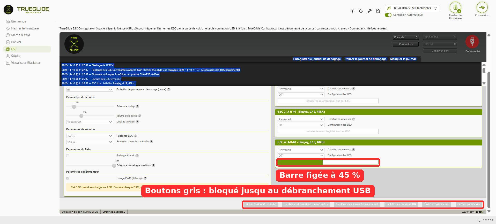
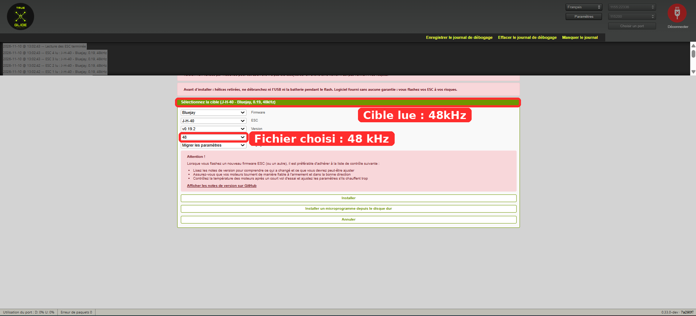
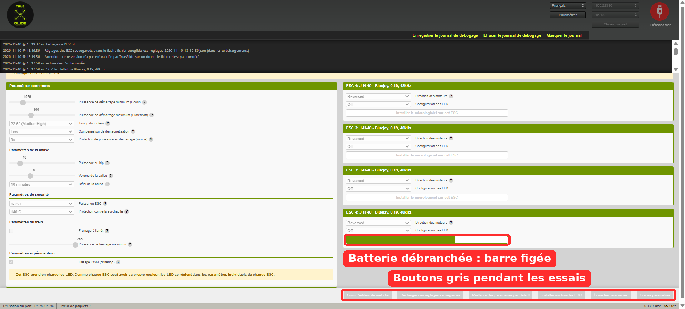
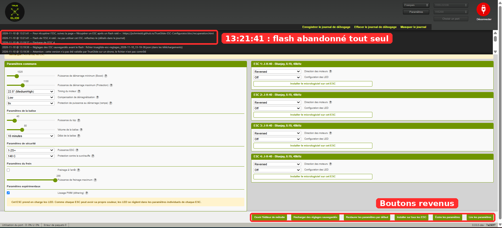
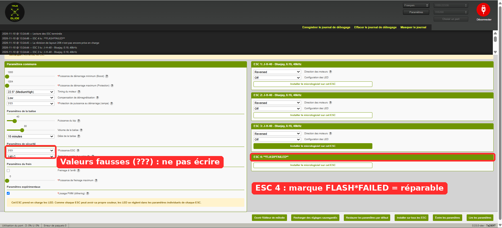
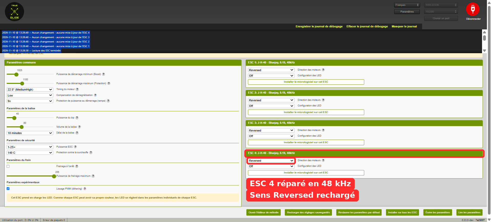
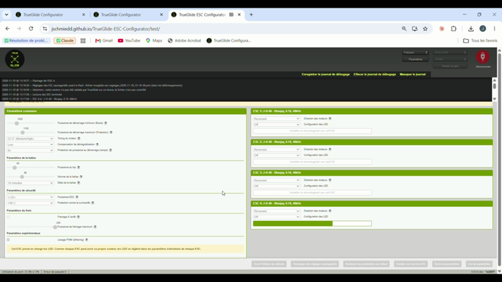
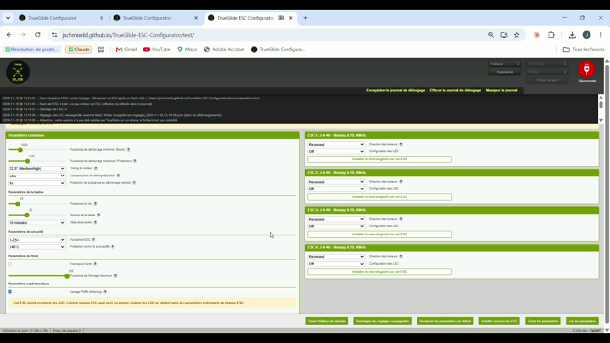
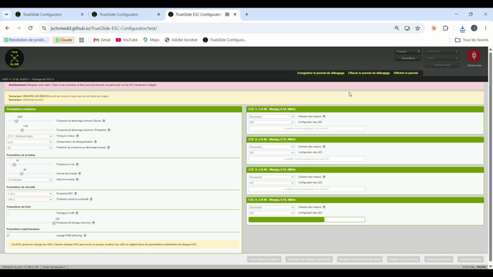
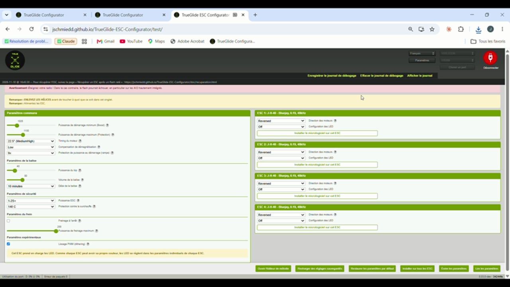

# Summary

By deliberately cutting the power of an ESC during its flash, test M6 revealed a defect in **ESC Configurator**, the original open source program (stylesuxx/esc-configurator) that TrueGlide ESC Configurator is based on:

- **the defect:** when the ESC loses its power while the flash is being verified, the program stays stuck on "Flashing ESC n", with all its buttons greyed out, for ever. The only way out is to unplug the USB cable;
- **the cause:** an error lost in the function that retries commands. It dates from the early days of the original project and is still present in its latest release (v0.32.1) and in its development branch (26/10/2026);
- **the fix:** a one-line change by TrueGlide, proven by 2 automated tests that fail on the old code;
- **bench check:** 2 tests on the fixed version. The program gives up the flash by itself in 2 to 2.5 minutes, shows a clear message, and the ESC can then be repaired normally.

A second test, in the afternoon, showed that a cut during the **write** phase still took far too long (about 14 minutes, until the page was reloaded). This is fixed in v24: the flash is given up in less than 60 s, checked on the bench (part 6). The tests also revealed 4 secondary defects (among them the log being erased by "Save"), also inherited from the original program. They are fixed (parts 4 and 6).

The screenshots are from the French user interface; the log files are in English.

# 1. The test

| | |
|---|---|
| Hardware | New SpeedyBee F405 Mini, TRUEGLIDE firmware 2026.6.2 (cb4e3f0f2, reported as "BTFL" by the program), J-H-40 4-in-1 ESC running Bluejay 0.19 48 kHz, output 4 burnt on the power side (stuttering), no motor |
| Safety | Propellers removed, battery through a smoke stopper |
| Goal | Check that an ESC whose flash is interrupted can still be repaired with the program |
| Method | Flash ESC 4 only, unplug the battery around the middle of the progress bar, wait, then repair |

The defect is in the ESC program, in the part that talks to the ESCs through the 4-way passthrough. This passthrough is the same as in Betaflight, so the result also applies to a Betaflight board. The 1 s motor guard (motors stopped when MSP messages stop), on the other hand, only exists in the TRUEGLIDE firmware.

# 2. The defect (previous version, ebaaf7f)



Morning log (full file in the appendix):

```
11:27:37  Flashing ESC 4
11:27:38  ### Step 3: Erase, write and verify Pages 0x02-0x0D
11:27:53  Failed processing command cmd_DeviceRead after 10 retries.
          ... nothing for 2 min 30: the program waits for ever ...
11:30:23  Reader failed NetworkError: The device has been lost.   (USB unplugged)
```

The ESC did not answer at 11:27:53, but the program never concluded. It stayed stuck until the user unplugged the USB cable.

**Procedure error in the morning.** The test sheet asked for the 24 kHz file although the ESCs ran at 48 kHz. Both morning flashes (11:27:36 and 11:36:12) therefore used J_H_40_24_v0.19.2.hex, as the log shows. This had no consequence here, since output 4 is out of order. It is however this error that revealed defect 4.2: after the 24 kHz reflash, ESC 4 was displayed as "48kHz". The sheet was corrected: flash the same frequency as the one read.

# 3. The cause

During a flash, every written page is read back to be verified. These checks go through a `retry()` function that retries up to 10 times. The original code (`src/utils/helpers/General.js`, identical in v0.32.1 and in the `develop` branch of 26/10/2026):

```js
async function retry(func, maxRetries, iterationDelay = 0) {
  function wrapped() {
    return new Promise((resolve,reject) => func(resolve, reject));
  }
```

The checks are **async** functions (`src/utils/FourWay.js`):

```js
const verifyPages = async (resolve, reject) => {
  const message = await this.read(address, Math.min(step, data.length - address));
```

When the ESC no longer answers, `this.read()` fails. The error leaves the async function, but **nobody listens to it**. The promise created by `wrapped()` is then neither resolved nor rejected: the flash waits for ever.

The same async functions verify the bootloader jump, the erase and the FLASH\*FAILED safety mark. The same hang is therefore possible at every step of the flash.

# 4. The fixes

## 4.1 Hang of the interrupted flash (7a290f7, online since v23)

```js
function wrapped() {
  return new Promise((resolve, reject) => {
    // An async function that throws rejects its own promise: pass it on
    Promise.resolve(func(resolve, reject)).catch(reject);
  });
}
```

The error is now passed on: the flash fails with the usual message, and the ESC stays repairable.

Added tests, which fail on the old code and pass with the fix:

- `retry()` with an async function that fails: 3 attempts, then rejection (before: endless wait);
- check of a page whose read fails: rejection in less than 3 s (before: stuck).

Result, from the test run by TrueGlide (the independent auditor could not run them): 521 tests out of 521 pass. After merging the 4 fixes: 526 out of 526.

## 4.2 Wrong displayed frequency (online since v23)

In Bluejay 0.19, the PWM frequency is fixed in the flashed file. The EEPROM byte is only used for **display** (Bluejay v0.19.2 source: "Temporary method for display"). When writing the settings, the original program copies all settings of the first ESC to the others, including this byte. An ESC flashed at 24 kHz was therefore displayed as "48kHz".

The fix only takes from the first ESC the common settings described for the ESC's version. It is checked by 2 tests, one of which fails on the old code.

## 4.3 "Timed out" message on disconnection after a passthrough (online since v23)

When disconnecting right after a failed read, the program still sent a motor stop command to the board, although it was in passthrough mode and could not answer. The error message appeared 1 s after "Closed port".

The fix takes the passthrough into account (the board stops the motors itself) and waits for the port to really close. Outside passthrough, the motor stop is kept. It is checked by 3 tests.

## 4.4 Bluejay 48 kHz file validated (online since v23)

The J-H-40 Bluejay 0.19.2 **48 kHz** file is added to the list of files validated by TrueGlide, with its SHA-256 taken from the official release:

`8731a3570f8f4f3122cbd06d18f44fc06bccb4d27af4885853d5410eb701ac07`

# 5. Bench check (fixed version, 7a290f7)

In the afternoon, the **48 kHz** file was chosen, as shown by the screenshot below and the log. At each flash, the log shows "Attention: this version has not been validated by TrueGlide on a drone" (13:06:56, 13:17:29, 13:19:36, 13:25:38). The only J-H-40 file validated at that time was the 24 kHz one, so the flashed file was not the 24 kHz one. Version 7a290f7 did not yet have fix 4.2, so the "48kHz" read back after the repair is not, on its own, a proof of the frequency.



| Test | Cut | Automatic abort | Repair |
|---|---|---|---|
| 1 | 13:06:57 | 13:09:26 (2 min 29) | Reflash OK in 10.9 s |
| 2 | 13:19:37 | 13:21:41 (2 min 04) | Reflash OK in 10.9 s, settings reloaded at 13:26:37 |









Frames from the video of test 2:





# 6. Second test (Q6): another path, a second fix

## 6.1 The test on v23 (15:51)

On v23, which contained fix 4.1, Johann cut the power again (validated 48 kHz file, SHA-256 checked at 15:51:56). The battery was unplugged around 40 % of the bar, during the **write** of the pages, whereas the 2 previous cuts had happened during the **verification**.

The flash did not give up: about 14 minutes of waiting (from 15:51:56 to the page reload at 16:05:55, then USB unplugged at 16:06:00), with the bar still and the buttons grey. The log shows a "cmd_DeviceRead failed" line at 16:04:25, among the failures of the keep-alive (TestAlive). The flash was therefore not frozen: it kept retrying, very slowly. The retries stack up: each command is retried 10 times with a growing delay (about 21 s), and each check repeats the command up to 10 times (about 3.5 min). At 16:04:25, more than 12 minutes after the start of the flash, it was still retrying, and it only stopped when the page was reloaded.

A second weak point of the original code was also found: the timeout of a command only started **after** its transmission had completed (`src/utils/helpers/QueueProcessor.js`). A transmission that never completes would therefore have blocked the queue without limit. This case is not proven by this test, since the log had been cleared during the wait: it is fixed as a precaution.

## 6.2 The second fix (v24, 34244fe)

- **Global watchdog.** After 30 s without any answer from the ESC, the flash is given up. The log then says "the flash has made no progress for 30 s (ESC without power?), it is given up", and no further command is sent. Any valid answer of the ESC counts as progress (the keep-alive answer, given by the flight controller, does not). A healthy but slow flash is therefore never interrupted: this is tested with 900 ms per answer, i.e. a 110 s flash.
- **Timeout from transmission.** The timeout of a command now starts when it is sent: a transmission that never completes can no longer block the queue.
- **Log kept.** In the original program (`src/Components/Log/index.jsx`, `handleSaveLog`), "Save debug log" **erased** the log right after downloading it: this is why several log files of the day were incomplete. The log is now kept, and "Clear" is disabled during a flash.
- **Tests.** Cut simulated at each of the 5 steps, with an ESC that times out or that does not answer at all: abort in less than 60 s (12 of the 16 cases fail on the old code). In total, 548 tests out of 548, from the test run by TrueGlide.

## 6.3 Bench check (v24, 16:44 and 16:51)

| Cut | Flash start | End | Repair |
|---|---|---|---|
| 1 | 16:44:51 | 16:45:29: "the flash has made no progress for 30 s", abort (39 s after the start) | Reflash OK in 10.9 s (16:50:45), settings reloaded (16:51:03) |
| 2 | 16:51:31 | 16:51:45: clean failure of the write (14 s) | Reflash OK in 10.9 s (16:52:29), settings reloaded (16:52:36) |

After each repair, the 4 ESCs are read back as "J-H-40 - Bluejay, 0.19, 48kHz".





The FLASH\*FAILED protection (part 7), in its first version, was also checked on the bench: at 16:07:26 and 16:07:28, "Nothing was written" was shown while ESC 4 was in FLASH\*FAILED. This behaviour was changed on 11 November (part 7).

# 7. Remaining points

- **Time to abort.** It was 2 to 2.5 minutes during a verification and about 14 minutes during the write. **Fixed in v24**: less than 60 s (part 6).
- **Wrong common settings while an ESC is in FLASH\*FAILED.** The screen then shows "???" and wrong values (1000, 1004, brake 0). Clicking "Write settings" could have written these values to the healthy ESCs. **Fixed** in two steps. First version (v24, checked on the bench on 10 November): while an ESC was in FLASH\*FAILED, "Write settings" and "Restore default settings" wrote nothing at all. Current version (11 November, after the review of #591 by the author of ESC Configurator; #591 and TrueGlide v25): each ESC in FLASH\*FAILED is skipped, with one log message per ESC skipped; the healthy ESCs are still written, melodies included; the common settings come from the first healthy ESC; with no healthy ESC, the common settings are not shown and nothing is copied. Unit tests, run by TrueGlide on v25: 552 out of 552, including 6 new ones that fail on the previous version. No bench test of v25 yet.
- **After an interrupted flash, the flight controller stays in passthrough.** The first reconnection fails ("Port initialization failed"). The USB cable must be unplugged and plugged in again before reading the ESCs. The program could say so.

# 8. Fixes proposed to ESC Configurator (11 November)

Each fix is proposed to the author of ESC Configurator as a separate pull request, with tests that fail without the fix:

| PR | Fix |
|---|---|
| #588 | `retry()` passes on the rejection of an async function (part 4.1); `flashTarget()` is awaited, so that a failing flash ends with the failure message and the buttons back (see the addendum) |
| #589 | The timeout of a command starts when it is sent (part 6.2). **Merged** into `develop` (dba1826) |
| #590 | The log is kept after saving it, and cannot be cleared during a flash (part 6.2) |
| #591 | The PWM frequency of Bluejay 0.19 is no longer copied from the first ESC (part 4.2); ESCs in FLASH\*FAILED are skipped (part 7) |
| #592 | 30 s watchdog (part 6.2), builds on #588 |
| #593 | Clean disconnection and more robust connection (part 4.3 and the addendum), follows #589 |

# 9. License and origin

TrueGlide ESC Configurator is derived from ESC Configurator (stylesuxx/esc-configurator), under the AGPL v3 license. The original code quoted in this report is from that project. The fixes are free software, like the rest of the program.

# Appendix

- `journaux/matin_ancienne-version_esc-configurator-log.txt`: full morning log (hang).
- `journaux/apres-midi_version-corrigee_journal-ecran.txt`: extract of the afternoon log (fixed version, French screen log).
- `journaux/q6_v23-v24_esc-configurator-log.txt`: full log of test Q6 (v23, 15:58 to 16:09) and of v24 (16:43 to 16:52). The board ID is masked.
- `journaux/trueglide-esc-reglages_2026-11-10_13-06-56.json`: settings backup taken before the flash and reloaded after the repair.
- `journaux/trueglide-esc-reglages_2026-11-10_13-25-38.json`: backup taken before the reflash, with ESC 4 in FLASH\*FAILED.
- Videos of the tests: provided by Johann, not included in the repository because of their size.
